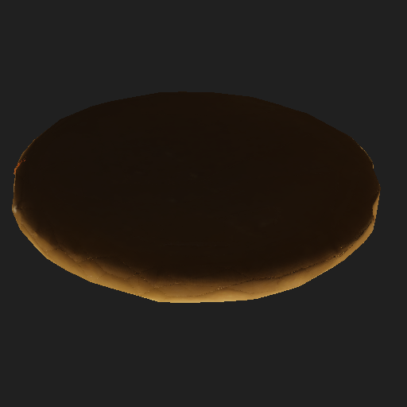

# Cookie

Copied unchanged from [HAG4R-MPC](https://github.com/ericchen321/HAG4R-MPC/tree/3624989aea2925f26166c33f1d09b109ed63aa80/assets/objects/cookie).
All 16 canonical export files are retained. See [the catalog](../README.md) for
validation scope, file hashes, source attribution and use with Newton.

- Metric mesh: 2,811 vertices, 11,920 tetrahedra; one connected volume.
- Extents: approximately 0.122 x 0.031 x 0.117 m in source axes.
- Parts are the cookie body and a small edge-crumb region.
- Both use E=3 GPa, nu=0.30 and density=700 kg/m3 in the source.

Suggested task: companion object for [kitchen tongs](../kitchen_tongs/).
The material is a stiff proxy; this asset does not implement fracture, crumbling
or food mechanics. Choose and record the scene's effective stiffness or rigid
treatment rather than assuming the source estimate has been calibrated.

