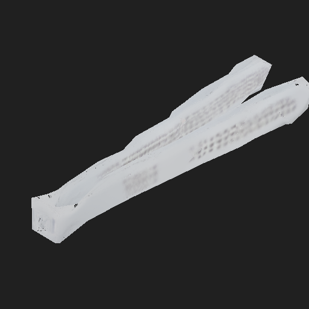

# Kitchen tongs

Copied unchanged from [HAG4R-MPC](https://github.com/ericchen321/HAG4R-MPC/tree/3624989aea2925f26166c33f1d09b109ed63aa80/assets/objects/kitchen_tongs).
All 16 canonical export files are retained. See [the catalog](../README.md) for
validation scope, file hashes, source attribution and use with Newton.

- Metric mesh: 967 vertices, 2,727 tetrahedra; one connected volume.
- Longest extent: approximately 0.288 m.
- Part 0 is the continuous flexible tong body; part 1 is a tiny grip-detail patch.
- Both parts use E=5 MPa, nu=0.49 and density=1100 kg/m3 in the source.

Suggested task: bend the arms to grasp, lift and place the [cookie](../cookie/).
This is a compliant one-piece tool, not an articulated metal hinge. Its two
labels currently have identical material properties. No Newton tongs task was
executed as part of this asset import.

