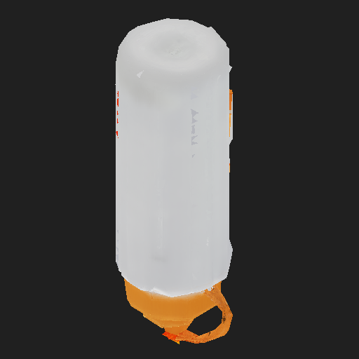

# Sauce keeper / squeeze bottle

Copied unchanged from [HAG4R-MPC](https://github.com/ericchen321/HAG4R-MPC/tree/3624989aea2925f26166c33f1d09b109ed63aa80/assets/objects/sauce_keeper_400ml).
All 16 canonical export files are retained. See [the catalog](../README.md) for
validation scope, file hashes, source attribution and use with Newton.

- Metric mesh: 13,031 vertices, 65,623 tetrahedra; one connected volume.
- Height along the source y-axis: approximately 0.204 m.
- Part 0 is the bottle body: E=2 GPa, nu=0.38, density=1050 kg/m3.
- Part 1 is the cap/nozzle/tether: E=2.2 GPa, nu=0.37, density=1100 kg/m3.

Suggested first use: visible bottle compression, with explicit effective
material overrides and recorded forces. The source stiffness ratio is only
1.1x, but both absolute stiffnesses are high. The mesh is also much denser than
the tongs, so runtime must be measured in the chosen scene.

**This bundle has no liquid.** The source labels the body `hollow_wall`, but the
exported material volume is about 0.000511 m3 and a usable internal fluid cavity
has not been established. Inspect or rebuild the cavity before implementing
dispensing; do not infer liquid readiness from the part description.

The [source squeeze demonstration](https://github.com/ericchen321/HAG4R-MPC/blob/3624989aea2925f26166c33f1d09b109ed63aa80/docs/sauce_keeper_pour.md)
explicitly has no simulated/rendered sauce and uses snap constraints, softened
materials and very large forces. That controller and its outcome are not being
imported as a validated Newton task.

