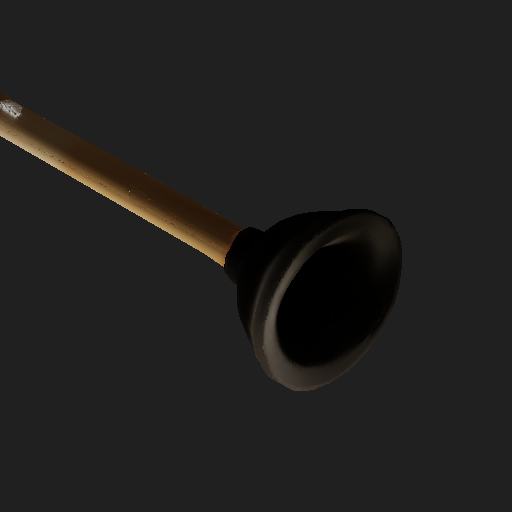

# Toilet plunger

Copied unchanged from [HAG4R-MPC](https://github.com/ericchen321/HAG4R-MPC/tree/3624989aea2925f26166c33f1d09b109ed63aa80/assets/objects/toilet_plunger).
All 16 canonical export files are retained. See [the catalog](../README.md) for
validation scope, file hashes, source attribution and use with Newton.

- Metric mesh: 3,899 vertices, 17,728 tetrahedra; one connected volume.
- Longest extent: approximately 0.407 m, along the source x-axis.
- Part 0 is the rubber cup: E=1 MPa, nu=0.48, density=1100 kg/m3.
- Part 1 is the wooden handle: E=20 GPa, nu=0.35, density=700 kg/m3.

Suggested task: compress the cup against a surface and observe its deformation.
The source stiffness contrast is **20,000x**. For the current project's <=100x
target, apply scene-level `part_overrides`; for example, keeping the cup at
1 MPa and setting the handle to 100 MPa gives 100x. This is an untested starting
configuration, not a calibrated or demonstrated result. Preserve the original
source arrays and record the effective parameters used by each scene.

The geometry alone does not provide suction or pressure/fluid behaviour.
No Newton plunger task was run during this import.

